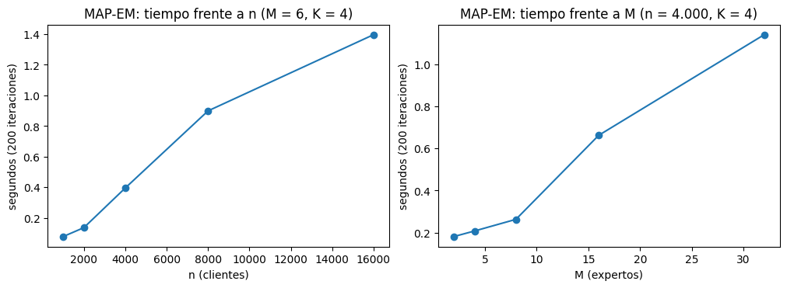
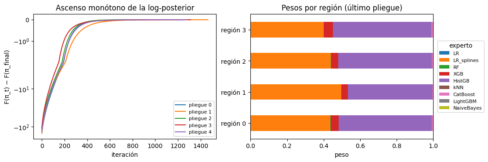

# Modelo propio: ponderación por regiones con MAP-EM {#modelo-propio -}

Este capítulo documenta el modelo original: la limitación que lo motiva, su formulación, la derivación de los pasos E y M, la propiedad teórica con su demostración, el pseudocódigo, la complejidad, la implementación propia, las pruebas unitarias y los pilotos exploratorios.

::: {.callout .callout-note}
[Resultado confirmatorio]{.callout-title}

- **Datos:** el dataset del proyecto, `WA_Fn-UseC_-Telco-Customer-Churn.csv`, solo el conjunto de desarrollo (5634 clientes de `train_index.csv`). El hold-out (1409 clientes de `test_index.csv`) no se usa en este capítulo.
- **R1 (novedad):** la regla de combinación no tiene antecedentes en churn; la revisión completa y la tabla de diferenciación están en el capítulo 4.
- **R2 (implementación propia):** clase `RegionalMAPEM` en `src/original_model.py`; el núcleo usa solo numpy y scipy; 12 pruebas unitarias.
- **R3 (superioridad):** no alcanzado. En la validación anidada pre-registrada, el modelo empata con la logística con splines (capítulo 6).
- Las secciones 9 y 10 son pilotos exploratorios, anteriores al protocolo. Los resultados confirmatorios están en los capítulos 6 y 7.
:::

## 1. Configuración {-}

```{r mp-02}
source("R/presentacion.R")
SEMILLA <- 42                                              # semilla raíz del proyecto
PROPIO <- "resultados_modelo_propio"                       # salidas guardadas de la implementación en Python (capítulo 5 del Jupyter Book)
PILOTO <- file.path("experiments", "pilotos", "piloto_kaggle", "resultados")   # resultados del piloto exploratorio (2026-11-07)
SALIDAS <- leer_json(file.path(PROPIO, "salidas.json"))
raw <- leer_csv("WA_Fn-UseC_-Telco-Customer-Churn.csv"); names(raw) <- trimws(names(raw))
train_ids <- leer_csv("train_index.csv")$train_index
test_ids <- leer_csv("test_index.csv")$test_index
stopifnot(length(intersect(train_ids, test_ids)) == 0)
X <- raw[train_ids + 1, setdiff(names(raw), c("customerID", "Churn"))]   # SOLO desarrollo: el hold-out no se toca
y <- as.integer(raw$Churn[train_ids + 1] == "Yes")
rm(raw)

NUMERIC <- c("tenure", "MonthlyCharges", "TotalCharges", "SeniorCitizen", "AvgChargePerMonth")
SERVICE <- c("OnlineSecurity", "OnlineBackup", "DeviceProtection", "TechSupport", "StreamingTV", "StreamingMovies")
CATEGORICAL <- setdiff(names(X), NUMERIC)

# ETL por filas del proyecto (no aprende nada): TotalCharges, servicios y AvgChargePerMonth
historical_features <- function(X) {
  out <- X; total <- suppressWarnings(as.numeric(out$TotalCharges))
  if (any(is.na(total) & out$tenure != 0)) stop("TotalCharges ausente con tenure != 0")
  out$TotalCharges <- ifelse(is.na(total), 0, total)
  for (c in SERVICE) out[[c]] <- replace(out[[c]], out[[c]] == "No internet service", "No")
  out$MultipleLines <- replace(out$MultipleLines, out$MultipleLines == "No phone service", "No")
  out$AvgChargePerMonth <- ifelse(out$tenure > 0, out$TotalCharges / out$tenure, out$MonthlyCharges)
  out
}
cat(sprintf("Desarrollo: %d clientes, %d variables, tasa de churn = %.3f, hold-out excluido: %d clientes\n",
            nrow(X), ncol(X), mean(y), length(test_ids)))
```

Se usa el dataset del proyecto (versión de Kaggle, 7043 × 21) con el mismo ETL por filas del entregable anterior (`HistoricalFeatures`) y el mismo preprocesamiento (`StandardScaler` + `OneHotEncoder(drop='first')`), ajustado dentro de cada pliegue. Solo se usa el conjunto de desarrollo: el hold-out queda reservado para la evaluación final, como fija el protocolo.

## 2. Motivación: la limitación identificada {-}

Los ensambles de churn de la literatura (Khoh et al., 2023; MetaLight-ChurnNet, 2026) y el stacking lineal combinan los modelos con **un único vector de pesos global**. Con eso suponen implícitamente que la fiabilidad relativa de cada modelo es la misma para todos los clientes.

**Hipótesis:** la fiabilidad relativa de los modelos cambia según el tipo de cliente. Si es así, una combinación con pesos por región debería poder aprovecharlo.

La evidencia empírica está en la sección 9. Que el mejor experto cambie entre regiones no basta: con expertos casi empatados, el ganador de cada región cambia también por azar. Una prueba de permutación de las regiones (piloto 8, sobre los 25 pliegues de desarrollo) muestra que la heterogeneidad existe, pero es débil. Los pesos por región ganan 0,0013 de log-verosimilitud por cliente frente a los globales, el doble de lo que ganan con regiones permutadas al azar (0,0007), y el resultado es significativo al 5 % en 15 de 25 pliegues. Ese exceso sobre el azar, de unos 0,0006 y medido dentro de la muestra, es una cota de lo que las regiones pueden aportar fuera de ella, y anticipa una ganancia pequeña.

## 3. Formulación {-}

Sea $\{(x_i, y_i)\}_{i=1}^{n}$ con $y_i \in \{0,1\}$, y sean $M$ expertos calibrados (los benchmarks), con probabilidades $p_m(x)$. Sean $K$ regiones con pertenencias suaves $r_k(x) \ge 0$ y $\sum_k r_k(x) = 1$. El modelo es

$$
p(y=1 \mid x) = \sum_{k=1}^{K} r_k(x) \sum_{m=1}^{M} \pi_{km}\, p_m(x), \qquad \pi_k \in \Delta^{M-1}. \tag{1}
$$

Con $\ell_{im} = p_m(x_i)^{y_i}\,(1-p_m(x_i))^{1-y_i}$, la verosimilitud de la mezcla es $\prod_i \sum_k \sum_m r_{ik}\pi_{km}\ell_{im}$. Se usa un prior $\pi_k \sim \mathrm{Dirichlet}(\alpha_k)$ con

$$
\alpha_{km} = 1 + c\, g_m , \tag{2}
$$

donde $g$ son los pesos globales (mismo EM con $K = 1$ y sin prior) y $c \ge 0$ es la intensidad del prior. El objetivo MAP es

$$
F(\pi) = \sum_{i=1}^{n} \log \sum_{k=1}^{K}\sum_{m=1}^{M} r_{ik}\,\pi_{km}\,\ell_{im} \;+\; \sum_{k,m} (\alpha_{km}-1)\log \pi_{km}. \tag{3}
$$

**Decisiones de diseño:**
- **Expertos fijos:** se reutilizan los benchmarks ya calibrados y no se reentrenan. Esto diferencia el modelo de la mezcla de expertos clásica.
- **Regiones no supervisadas (regla del protocolo, sección 6):** las variables continuas (más de 2 valores distintos) se llevan a cuantiles normales, se proyectan sobre sus 2 primeras componentes principales y sobre ellas se ajusta un GMM propio, antes que los pesos.
- **Prior hacia los pesos globales:** una región con pocos clientes no puede alejarse mucho de la combinación global, lo que regulariza.
- **Predicciones fuera de pliegue:** $p_m(x_i)$ en el entrenamiento viene de una CV interna, sin fuga.

## 4. Derivación del EM {-}

Se introduce la variable latente $z_i = (k, m)$: qué región y qué experto "explican" al cliente $i$.

**Paso E.** Responsabilidades con los pesos actuales $\pi^{(t)}$:

$$
q_{ikm} = \frac{r_{ik}\,\pi^{(t)}_{km}\,\ell_{im}}{\sum_{k'}\sum_{m'} r_{ik'}\,\pi^{(t)}_{k'm'}\,\ell_{im'}} . \tag{4}
$$

**Paso M.** Se maximiza $Q(\pi) = \sum_{i,k,m} q_{ikm}\log \pi_{km} + \sum_{k,m}(\alpha_{km}-1)\log\pi_{km}$ sujeto a $\sum_m \pi_{km} = 1$ para cada $k$. El lagrangiano $Q(\pi) - \sum_k \lambda_k(\sum_m \pi_{km} - 1)$ da $\partial/\partial \pi_{km}$: $(\sum_i q_{ikm} + \alpha_{km} - 1)/\pi_{km} = \lambda_k$. Sumando sobre $m$ se despeja $\lambda_k$:

$$
\pi^{(t+1)}_{km} = \frac{\sum_i q_{ikm} + \alpha_{km} - 1}{\sum_i \sum_{m'} q_{ikm'} + \sum_{m'}(\alpha_{km'} - 1)} . \tag{5}
$$

Con $\alpha_{km} \ge 1$ el numerador es no negativo, así que $\pi^{(t+1)}$ queda en el símplex. Con $c = 0$ y $K = 1$ se recupera la estimación de máxima verosimilitud de una mezcla con componentes fijos.

## 5. Propiedad teórica {-}

::: {.tc-prf .tc-prf-proposition}
[Proposition 1 (Concavidad, ascenso monótono y óptimo global)]{.tc-prf-title}

Supóngase que (S1) $\ell_{im} > 0$ para todo $i, m$; (S2) las regiones $r_{ik}$ están fijas durante el EM; (S3) $\alpha_{km} \ge 1$; y (S4) el punto de partida es estrictamente positivo, $\pi^{(0)}_{km} > 0$ para todo $k, m$. Entonces:
1. $F$ es cóncava sobre el conjunto convexo $\mathcal D = \Delta^{M-1} \times \cdots \times \Delta^{M-1}$.
2. El EM de (4)–(5) cumple $F(\pi^{(t+1)}) \ge F(\pi^{(t)})$ para todo $t$.
3. La sucesión $F(\pi^{(t)})$ converge al máximo **global** $F^\ast = \max_{\mathcal D} F$, y todo punto límite de $\pi^{(t)}$ es un maximizador global de $F$ en $\mathcal D$.
:::

**Demostración.**

1. Para cada $i$, $s_i(\pi) = \sum_{k,m} r_{ik}\ell_{im}\pi_{km}$ es afín en $\pi$ y, por (S1), positiva en $\mathcal D$. Como $\log$ es cóncava y no decreciente, $\log s_i(\pi)$ es cóncava. Por (S3), $(\alpha_{km} - 1)\log \pi_{km}$ es cóncava (o nula). La suma de funciones cóncavas es cóncava, y $\mathcal D$ es un producto de símplex, que es convexo.
2. Por la desigualdad de Jensen, para cualquier distribución $q_i$ sobre $(k,m)$: $\log s_i(\pi) \ge \sum_{k,m} q_{ikm}\log\big(r_{ik}\pi_{km}\ell_{im}/q_{ikm}\big)$. La igualdad se alcanza en $\pi^{(t)}$ cuando $q$ es (4). El paso M maximiza esa cota inferior más el log-prior (el problema es cóncavo y (5) es su solución exacta por KKT). Por tanto $F(\pi^{(t+1)}) \ge \text{cota}(\pi^{(t+1)}) \ge \text{cota}(\pi^{(t)}) = F(\pi^{(t)})$ (Dempster, Laird y Rubin, 1977).
3. *Convergencia de los valores.* Por (S1), $s_i(\pi) \ge \min_m \ell_{im} > 0$ en todo $\mathcal D$, porque $\sum_k r_{ik} = 1$ y $\sum_m \pi_{km} = 1$. Por tanto, $F$ solo vale $-\infty$ donde $\pi_{km} = 0$ con $\alpha_{km} > 1$. El conjunto de nivel $\mathcal L_0 = \{\pi \in \mathcal D : F(\pi) \ge F(\pi^{(0)})\}$ es cerrado, está dentro del compacto $\mathcal D$ y en él $F$ es continua. La sucesión $F(\pi^{(t)})$ es no decreciente (parte 2) y está acotada por $\max_{\mathcal L_0} F$, así que converge.

   *Puntos límite.* Se distinguen dos casos.

   **(a) $\alpha_{km} > 1$ para todo $k, m$.** En $\mathcal L_0$ cada $\pi_{km}$ está acotado lejos de 0, porque si no $F \to -\infty$. Entonces $\mathcal L_0$ queda en el interior relativo de $\mathcal D$, donde el mapa del EM es continuo. Por Wu (1983, teorema 2), todo punto límite es un punto estacionario de $F$ restringida a $\mathcal D$. En el interior relativo, la estacionariedad equivale a las condiciones KKT, y en un problema cóncavo (parte 1) todo punto KKT es un máximo global.

   **(b) Algún $\alpha_{km} = 1$**, por ejemplo con $c = 0$ o con un peso global $g_m = 0$. El óptimo puede estar en el borde del símplex. Ahí el resultado de Wu no basta: un punto fijo del EM con $\pi_{km} = 0$ no tiene por qué cumplir KKT, porque el paso M es multiplicativo,

   $$\pi^{(t+1)}_{km} = \frac{\pi^{(t)}_{km}\, \sum_i r_{ik}\ell_{im}/s_i(\pi^{(t)}) + \alpha_{km} - 1}{\sum_{m'}\big(\pi^{(t)}_{km'}\, \sum_i r_{ik}\ell_{im'}/s_i(\pi^{(t)}) + \alpha_{km'} - 1\big)},$$

   y una coordenada que vale 0 se queda en 0. Por eso hace falta (S4). Con $\pi^{(0)} > 0$, la fórmula anterior y (S1) implican que $\pi^{(t)}_{km} > 0$ para todo $t$ finito. Además, el término del prior equivale a observaciones ficticias: $(\alpha_{km} - 1)\log\pi_{km}$ es la log-verosimilitud, con peso $\alpha_{km} - 1 \ge 0$, de un "cliente" cuya función $s(\pi)$ es simplemente $\pi_{km}$. Así, $F$ es una log-verosimilitud ponderada de la misma forma, $\sum_j w_j \log(\text{función lineal y positiva de } \pi)$, y cada iteración del EM es un paso de minimización alternada de la divergencia I entre dos conjuntos convexos:
   - las distribuciones $q$ con marginal fija en los clientes;
   - el modelo $r_{ik}\pi_{km}\ell_{im}$ con $\pi$ en el producto de símplex.

   Para esta estructura, Csiszár y Tusnády (1984, teorema 3) demuestran que, desde un punto de partida estrictamente positivo, los valores convergen al óptimo: $F(\pi^{(t)}) \to F^\ast$. El mismo resultado, para el EM de pesos de mezcla con componentes fijas, está en Vardi, Shepp y Kaufman (1985, sección 3). Por continuidad de $F$ en $\mathcal L_0$, todo punto límite $\bar\pi$ cumple $F(\bar\pi) = F^\ast$, es decir, es un maximizador global. $\blacksquare$

   *Verificación numérica del caso (b):* `test_optimo_global_en_el_borde` construye un problema con $\alpha = 1$ cuyo óptimo tiene un peso nulo. Comprueba que el EM, partiendo de pesos uniformes, alcanza el mismo valor de $F$ que un optimizador independiente (Nelder-Mead) y lleva a 0 el peso del experto dañino.

**Plausibilidad de los supuestos en Telco:**
- (S1) se garantiza recortando las probabilidades a $[10^{-6}, 1 - 10^{-6}]$.
- (S2) se cumple por construcción: el GMM se ajusta antes y queda fijo.
- (S3) se cumple porque $c \ge 0$ y $g$ está en el símplex.
- (S4) se cumple por construcción: `map_em` parte de pesos uniformes $1/M$.

**Unicidad.** Si además $c > 0$ y $g_m > 0$ para todo $m$, entonces $\alpha_{km} > 1$ y cada término $(\alpha_{km}-1)\log\pi_{km}$ es estrictamente cóncavo, así que $F$ es estrictamente cóncava y el óptimo es **único**. Si algún $g_m = 0$ (en Telco varios expertos reciben peso global casi nulo) o $c = 0$, puede haber un conjunto de óptimos con el mismo valor de $F$; la convergencia al valor óptimo global se mantiene.

**Alcance:** la propiedad cubre la etapa de pesos. El GMM de regiones es otro EM, con su propio ascenso monótono, pero no es cóncavo: sus regiones dependen de la inicialización (k-means++ con semilla fija).

**Verificación numérica:** `test_log_posterior_nunca_baja`, `test_optimo_global_por_concavidad` y `test_optimo_global_en_el_borde` (sección 8), y el historial de $F$ en Telco (sección 9).

**Velocidad.** La proposición garantiza convergencia, pero no rapidez. El EM converge, como mucho, linealmente, y se vuelve lento cuando el óptimo tiene pesos cerca de 0 (caso b). Eso explica por qué, con 9 expertos, 500 iteraciones no alcanzaban la tolerancia de $10^{-9}$ en el piloto 6b, y por qué `max_iter` subió a 5000.

## 6. Algoritmo {-}

::: {.tc-prf .tc-prf-algorithm}
[Algorithm 1 (RegionalMAPEM)]{.tc-prf-title}

**Entradas:** $X \in \mathbb R^{n\times p}$, $y \in \{0,1\}^n$, expertos $\{f_m\}_{m=1}^M$, $K$, $c$, pliegues internos $V$, tolerancia $\varepsilon$, $T_{\max}$.

**Salidas:** expertos calibrados reentrenados, regiones $(\mu, W, \text{GMM})$, pesos $\pi \in \mathcal D$.

1. Para $v = 1..V$: entrenar cada $f_m$ calibrado (Platt) en los pliegues $\neq v$ y predecir el pliegue $v$, lo que da $P^{\text{oof}} \in [0,1]^{n\times M}$.
2. Reentrenar cada $f_m$ calibrado con todo $X$.
3. Calcular $\ell_{im}$ a partir de $P^{\text{oof}}$ recortado a $[10^{-6}, 1-10^{-6}]$.
4. Tomar las columnas continuas de $X$, llevarlas a cuantiles normales $\Phi^{-1}(\text{rango}/(n+1))$, PCA por SVD con $d = 2$ componentes y estandarizar: $Z$.
5. GMM de $K$ componentes por EM (inicialización k-means++), lo que da $r_{ik}$.
6. Pesos globales $g$: EM con $K = 1$, $\alpha = 1$.
7. $\alpha_{km} \leftarrow 1 + c\,g_m$; $\pi^{(0)} \leftarrow 1/M$.
8. **Repetir:** paso E (4); paso M (5); **hasta** $F(\pi^{(t+1)}) - F(\pi^{(t)}) \le \varepsilon(1 + |F(\pi^{(t)})|)$ o $t = T_{\max}$.
9. **Predicción:** $\hat p(x) = \sum_k r_k(x)\sum_m \pi_{km} f_m(x)$.
:::

## 7. Complejidad {-}

| Etapa | Entrenamiento | Predicción ($n'$ clientes) |
|---|---|---|
| Expertos (CV interna + reentrenamiento) | $(V+1)\sum_m C_m(n)$ | $\sum_m C^{\text{pred}}_m(n')$ |
| PCA (SVD) | $O(n p^2)$ | $O(n' p d)$ |
| GMM ($T_g$ iteraciones, dimensión $d$) | $O(T_g\,(n K d^2 + K d^3))$ | $O(n' K d^2)$ |
| MAP-EM ($T$ iteraciones) | $O(T\, n K M)$ | $O(n' K M)$ |

El costo lo dominan los expertos. El aporte propio (GMM + MAP-EM) es lineal en $n$, $K$ y $M$ por iteración. La celda siguiente mide el tiempo del MAP-EM con un número fijo de iteraciones para comprobar la linealidad en $n$ y en $M$.

```{r mp-10}
# Medición del tiempo del MAP-EM con 200 iteraciones fijas (n = 1000 a 16 000 con M = 6; M = 2 a 32 con n = 4000; K = 4),
# hecha sobre la implementación en numpy del modelo; se muestran la figura y el resultado guardados.

cat(SALIDAS$tiempo_map_em, "\n")
```

En $n$ la pendiente log-log es cercana a 1, lo que confirma el costo lineal. En $M$ sale por debajo de 1 porque, con pocos expertos, domina el costo fijo de las operaciones vectorizadas: $O(nKM)$ es la cota superior del costo por iteración, y la medición queda por debajo de ella.

## 8. Implementación y pruebas unitarias {-}

La clase hereda de `BaseEstimator` y `ClassifierMixin`, así que funciona dentro de un `Pipeline`, con `clone` y con la validación anidada del entregable anterior. scikit-learn solo aporta la interfaz, la validación de entradas y los expertos (que son los benchmarks). La PCA, el GMM y el MAP-EM están programados en numpy y scipy.

```{r mp-13}
# Código fuente de map_em y de RegionalMAPEM.fit (src/original_model.py del repositorio del Jupyter Book)
cat(readLines(file.path(PROPIO, "map_em_fuente.txt"), encoding = "UTF-8"), sep = "\n")
```

Pruebas (`tests/test_original_model.py`, 12 pruebas). Cubren, entre otras, cinco propiedades: aprende, es reproducible, rechaza entradas inválidas, funciona con `clone` y cumple la propiedad teórica.

```{r mp-15}
# Resultado de las 12 pruebas unitarias (pytest -v tests/test_original_model.py)
cat(tail(readLines(file.path(PROPIO, "pruebas_unitarias.txt"), encoding = "UTF-8"), 2500), sep = "\n")
```

## 9. Validación en Telco (exploratoria) {-}

Validación sobre los **5 pliegues externos de la repetición 0** (`seed_for('outer', 0)`, los mismos del entregable anterior), con el ETL y el preprocesamiento dentro del pipeline. Los expertos son los 9 del piloto, sin SMOTE y calibrados con Platt, con hiperparámetros fijos; el modelo propio usa $K = 4$ y $c = 20$. El confirmatorio optimizará todos los hiperparámetros con el mismo presupuesto.

```{r mp-17}
# Piloto en los 5 pliegues externos de la repetición 0 (seed_for('outer', 0)): RegionalMAPEM con K = 4 y c = 20 sobre
# los 9 expertos calibrados con Platt, sin SMOTE. Media ± desviación estándar por modelo, ordenada por log-loss.
T51 <- leer_csv(file.path(PROPIO, "tabla_5_1_piloto_repeticion0.csv"), colClasses = "character")
tabla(T51, "Tabla 5.1. Piloto en los 5 pliegues de la repetición 0 de Telco")
```

Los expertos se evalúan dentro del mismo modelo ajustado, así que comparten exactamente el preprocesamiento, los pliegues y la calibración. Es una comparación pareada.

```{r mp-19}
# Izquierda: F(π_t) − F(π_final) en cada pliegue; derecha: pesos por región del último pliegue

cat(SALIDAS$convergencia, "\n")
```

### Evidencia de la limitación: la fiabilidad de los expertos cambia por región {-}

La celda siguiente cuenta en cuántos pliegues cambia el mejor experto entre regiones duras. Ese conteo, por sí solo, no prueba nada: con regiones asignadas al azar el mejor experto también cambia, en promedio, en el 76 % de los casos. La prueba que separa la señal del azar está después de la celda.

```{r mp-21}
# Log-loss fuera de pliegue de cada experto en cada región dura (argmax de las pertenencias) y mejor experto por región
cat(SALIDAS$heterogeneidad, "\n")
T52 <- leer_csv(file.path(PROPIO, "tabla_5_2_logloss_por_region_pliegue0.csv"), colClasses = "character")
tabla(T52, "Tabla 5.2. Log-loss fuera de pliegue de cada experto por región dura (pliegue 0)", decimales = 3)
```

**Prueba de permutación de las regiones (piloto 8, `experiments/pilotos/piloto_heterogeneidad.py`).** En cada uno de los 25 pliegues de desarrollo se calcula

$$T = \frac{1}{n}\sum_i \log s_i(\hat\pi_{\text{regional}}) - \frac{1}{n}\sum_i \log s_i(\hat g),$$

la ganancia de log-verosimilitud por cliente de los pesos por región ($K = 4$, $c = 0$) frente a los pesos globales, con las predicciones fuera de pliegue de los expertos. Bajo $H_0$ (la fiabilidad relativa de los expertos no depende de la región), permutar entre clientes las filas de $R$ no cambia la distribución de $T$. Se usan $B = 200$ permutaciones y $p = (1 + \#\{T_{\text{perm}} \ge T\})/(B + 1)$.

| Medida | Valor |
|---|---|
| $T$ medio (regiones reales) | 0,00134 |
| $T$ medio con regiones permutadas | 0,00069 |
| Exceso sobre el azar | 0,00064 |
| Pliegues con $p < 0{,}05$ | 15 de 25 (se esperarían 1,25 bajo $H_0$) |
| $p$ mediano | 0,040 |
| Pliegues en que cambia el mejor experto: real / bajo $H_0$ | 24 de 25 / 76 % |

**Lectura.** Hay heterogeneidad regional real, pero pequeña: las regiones capturan, dentro de la muestra, unos 0,0006 de log-verosimilitud por cliente por encima de lo que capturaría una partición al azar. Fuera de la muestra, la ablación del piloto 6b da 0,0001, lo esperable cuando una señal tan débil se estima con unos 1100 clientes por región. Los pliegues no son independientes (comparten clientes), así que no se combinan sus valores $p$ en uno solo; el resultado se reporta como evidencia descriptiva. Esto explica por qué el prior hacia los pesos globales es necesario y por qué no se espera que las regiones, por sí solas, produzcan una superioridad significativa.

## 10. Pilotos exploratorios e iteraciones de diseño {-}

Antes de congelar el protocolo evaluamos varias iteraciones de diseño; la tabla las registra todas. Todas usan expertos calibrados con Platt, sin SMOTE, y log-loss como métrica.

| Iteración | Fecha | Datos | Qué cambió | Resultado |
|---|---|---|---|---|
| 0 | 2026-10-30 | IBM extendido | SVM+ (LUPI) con CLTV y Churn Score | F1 0,35 frente a 0,58 sin información privilegiada; riesgo de fuga y variables que no existen en el dataset del proyecto → **descartado** |
| 1–3 | 2026-11-03 | IBM extendido, 7043 clientes | MAP-EM por regiones, 7 reglas, 6–9 expertos | Empate con HistGB; solo Wilcoxon significativo |
| **4** | **2026-11-07** | **Dataset del proyecto, solo desarrollo (5634)** | **Repetición de la regla elegida con la regla de regiones del protocolo, 9 expertos y ablación** | **Ver tablas siguientes** |
| 5 | 2026-11-08 | Dataset del proyecto, solo desarrollo (5634) | Prueba de permutación de las regiones sobre los pliegues de la iteración 4 | Heterogeneidad real pero débil: exceso de 0,0006 sobre el azar; $p < 0{,}05$ en 15 de 25 pliegues (sección 9) |

::: {.callout .callout-warning}
[Desviación declarada]{.callout-title}

Las iteraciones 0 a 3 se corrieron por error con `Telco_customer_churn.xlsx` (versión extendida de IBM) y con los 7043 clientes, incluido el hold-out. Ninguna cifra de esas iteraciones se usa en este capítulo ni en el protocolo. La iteración 4 repite el análisis con el dataset del proyecto y solo con el conjunto de desarrollo. Como el hold-out ya intervino en decisiones exploratorias de diseño (la elección de la familia), su evaluación final se reporta con esta advertencia.
:::

Piloto de la iteración 4: 5 repeticiones × 5 pliegues externos (`seed_for('outer', r)`), cross-fitting interno de 3 pliegues para los pesos, 9 expertos con hiperparámetros fijos (código en `experiments/pilotos/piloto_kaggle/`).

```{r mp-24}
# Resumen del piloto: cabecera de dos niveles (métrica, estadístico) como la guardó el piloto
lineas <- readLines(file.path(PILOTO, "resumen.csv"), encoding = "UTF-8")
metricas <- strsplit(lineas[1], ",")[[1]][-1]; estadisticos <- strsplit(lineas[2], ",")[[1]][-1]
resumen <- leer_csv(file.path(PILOTO, "resumen.csv"), header = FALSE, skip = 3)
vista <- data.frame(`Método` = resumen[[1]], check.names = FALSE)
for (k in unique(metricas)) {
  media <- resumen[[1 + which(metricas == k & estadisticos == "mean")]]
  de <- resumen[[1 + which(metricas == k & estadisticos == "std")]]
  vista[[paste0(k, " (media ± de)")]] <- media_de(media, de)
}
tabla(vista, "Tabla 5.3. Piloto con el dataset del proyecto: resumen por método (25 pliegues de desarrollo)")
```

```{r mp-25}
pruebas <- leer_csv(file.path(PILOTO, "pruebas_vs_rivales.csv"))
cols <- c(rival = "Rival", dif_logloss = "Diferencia de log-loss", pliegues_gana = "Pliegues ganados (de 25)",
          h_NB = "p Holm (Nadeau-Bengio)", h_wilcoxon = "p Holm (Wilcoxon)", h_perm = "p Holm (permutación)",
          nemenyi_sig = "Nemenyi significativo", cliff = "δ de Cliff", dz = "d_z")
vista <- setNames(pruebas[names(cols)], cols)
tabla(vista, "Tabla 5.4. Piloto: RegionalMAPEM frente a cada rival (exploratorio)",
      columnas_p = c("p Holm (Nadeau-Bengio)", "p Holm (Wilcoxon)", "p Holm (permutación)"))
```

**Lectura.**
- **Frente a los benchmarks:** el modelo propio (log-loss 0,4116) le gana con las tres pruebas (Nadeau-Bengio, Wilcoxon y permutación, con Holm) a 7 de los 9 benchmarks. Frente a HistGB gana en 21 de 25 pliegues ($\delta = -0{,}17$), pero solo Wilcoxon es significativo. El mejor benchmark es la **logística con splines (0,4128)**: el propio gana en 17 de 25 pliegues, pero solo Wilcoxon es significativo; Nadeau-Bengio, la permutación y Nemenyi no lo son, y $|\delta| = 0{,}05$ es despreciable. **R3 no se cumple.**
- **Ablación:** las regiones aportan 0,0001 frente a los pesos globales (K = 1), y el modelo empata con el stacking lineal, la variante sin prior y la de regiones duras. La ganancia viene de combinar expertos, no de las regiones.
- **Coincide con la auditoría del dataset publicada en arXiv (2026):** sin fuga, la logística y el gradient boosting son el techo y ningún método los supera significativamente.

## 11. Novedad y diferenciación frente a trabajos cercanos {-}

La revisión de literatura, la matriz de búsqueda, la búsqueda por citación y la tabla de diferenciación con diez
familias de métodos están en el capítulo 4. En resumen, la idea de integrar clasificadores por zonas del espacio
de clientes ya existe en churn (modelos por segmento y subáreas de k-means con pesos por metaheurística). Lo nuevo es la
regla: pertenencias suaves, expertos fijos que no se reentrenan por región, MAP-EM con objetivo cóncavo y óptimo global
garantizado (sección 5), y un prior de Dirichlet que encoge los pesos de cada región hacia los globales.
