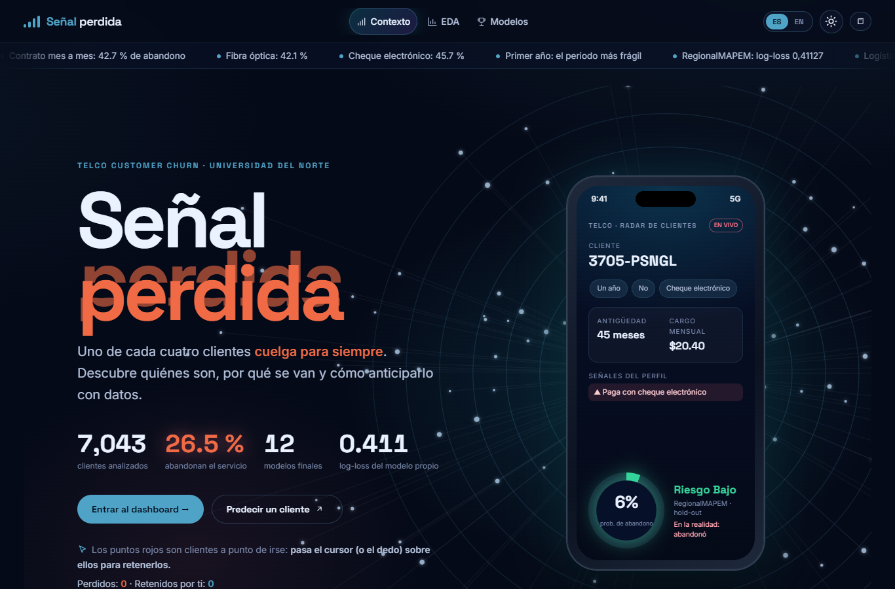
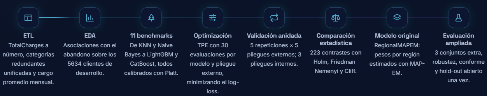
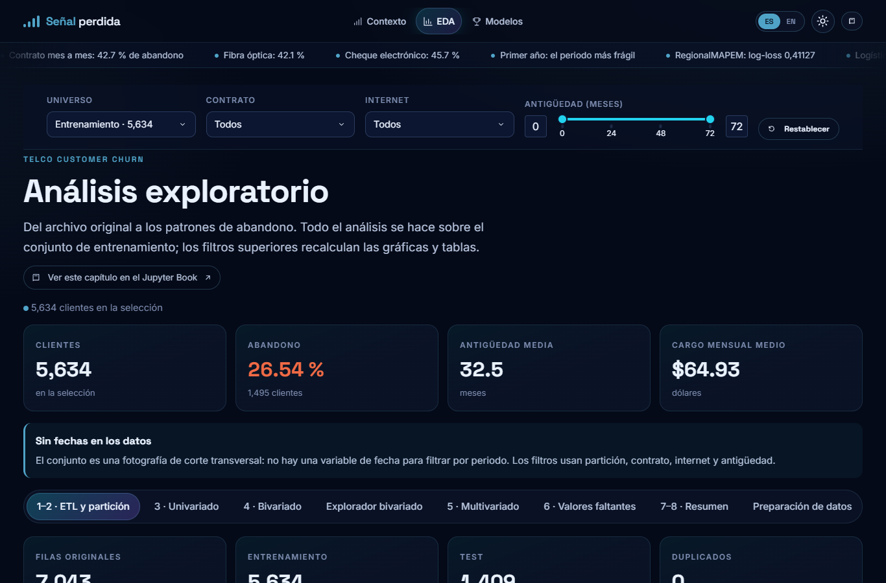
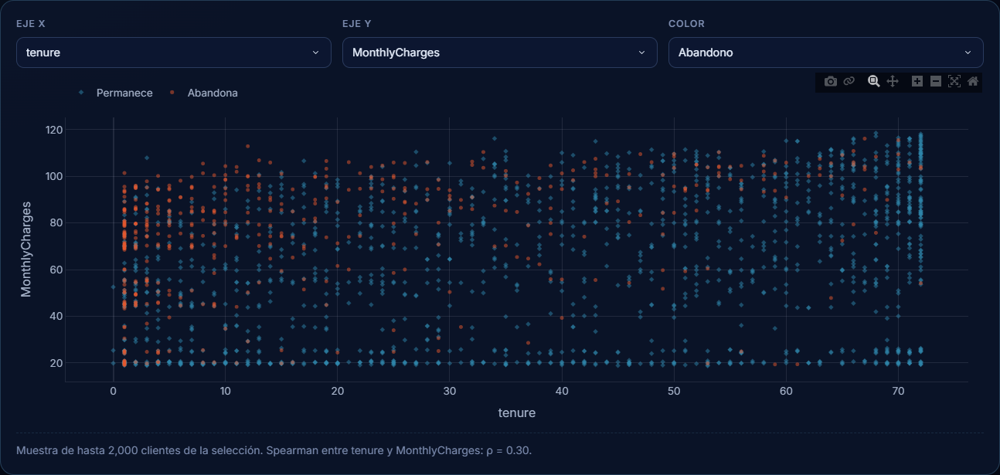
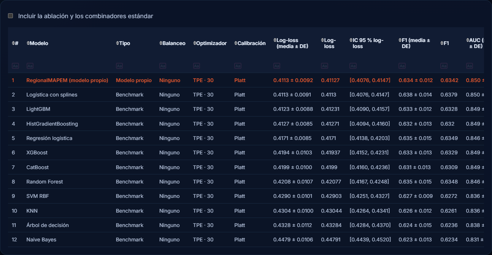
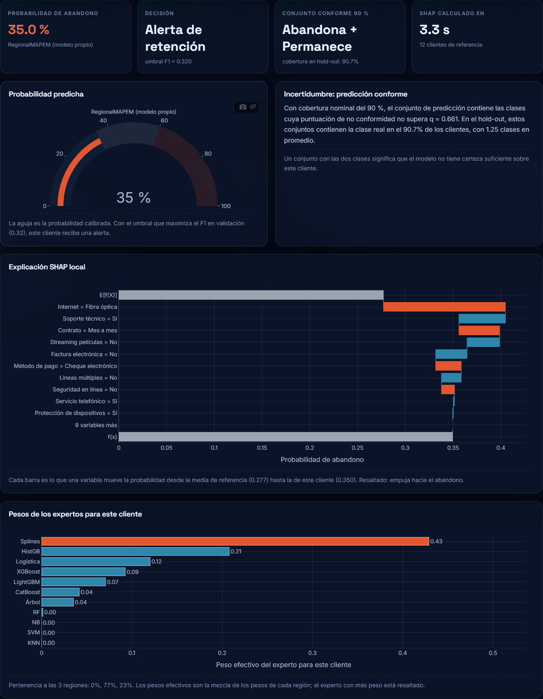
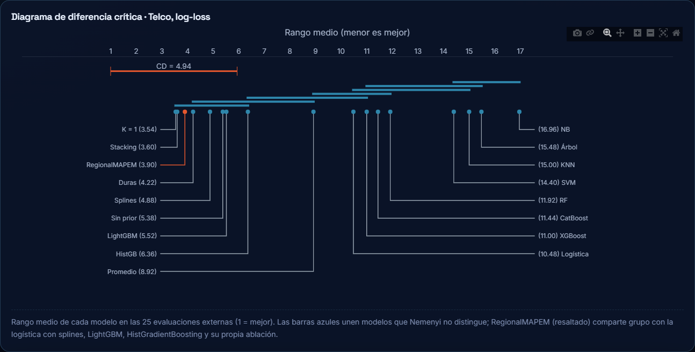
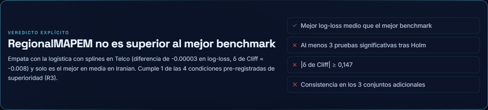
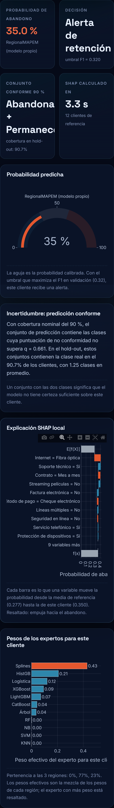

# Dashboard y despliegue {#dashboard -}

El dashboard pone el proyecto en manos de alguien que no va a leer el libro: explica el problema, deja explorar los datos
y usa los doce modelos finales para predecir el riesgo de abandono de un cliente. Está construido con Dash y Plotly, se
publica en Render y su código está en [Dash_Telco_Churn_ML](https://github.com/lauraformore/Dash_Telco_Churn_ML).

- **URL pública:** [https://telco-churn-dashboard-hom3.onrender.com/](https://telco-churn-dashboard-hom3.onrender.com/)
- **Repositorio:** [https://github.com/lauraformore/Dash_Telco_Churn_ML](https://github.com/lauraformore/Dash_Telco_Churn_ML)
- **Ejecución local:** `pip install -r requirements.txt` y `python app.py` (http://localhost:8050)

## Arquitectura {-}

La aplicación es multipágina (`use_pages=True`), con una página por sección: **Contexto** (`/`), **EDA** (`/eda`) y
**Modelos** (`/modelos`). La interfaz, la lógica de datos y los artefactos de modelo están separados:

```{r dash-tabla-8-1}
source("R/presentacion.R")
# Capas del dashboard (repositorio Dash_Telco_Churn_ML)
capas <- data.frame(
  Capa = c("Interfaz", "Datos", "Modelos", "Figuras", "Artefactos", "Construcción", "Calidad"),
  Archivos = c("app.py, pages/contexto.py, pages/eda.py, pages/modelos.py, assets/", "src/data.py, data/",
               "src/modelos.py, src/pipeline_telco.py, src/original_model.py", "src/plots.py, src/ui.py",
               "artifacts/<modelo>/modelo.joblib y metadata.json", "scripts/construir_artefactos.py, scripts/preparar_resultados.py",
               "tests/, .github/workflows/pytest.yml"),
  Responsabilidad = c("Barra de navegación, idioma, tema, layout y callbacks de cada página",
                      "Carga única del conjunto, de los índices de la partición y de las tablas copiadas del experimento",
                      "Carga de artefactos, validación de entradas, predicción, conformal y SHAP",
                      "Paleta, plantilla común y funciones que construyen cada figura y componente",
                      "Los 12 modelos finales, de solo lectura", "Reentrenamiento y copia de resultados; nunca corren en el servidor",
                      "75 pruebas que GitHub Actions ejecuta en cada push"))
tabla(capas, "Tabla 8.1. Capas del dashboard", buscar = FALSE)
```

```text
Navegador ──HTTPS──▶ gunicorn (1 proceso, 4 hilos) ──▶ app.py (Dash, use_pages)
                                                       ├─ pages/            layout y callbacks de cada sección
                                                       ├─ src/data.py       datos y resultados, cargados una vez
                                                       ├─ src/modelos.py    12 artefactos cargados una vez
                                                       └─ src/plots.py      figuras
```

Al arrancar, el proceso carga el conjunto, las tablas de resultados y los doce artefactos (`functools.lru_cache`). Ningún
callback entrena ni optimiza: una prueba revisa que ningún módulo del servidor llame a `fit`. Cada página dibuja su
contenido en un callback propio que depende del idioma, y los filtros del EDA solo recalculan las gráficas de esa página.

Una predicción recorre estos pasos:

1. El formulario se genera con el esquema de entrada guardado en `metadata.json` (tipos, categorías válidas y rangos
   observados en el desarrollo). Cargar un cliente del hold-out llena los 19 campos.
2. `src/modelos.validar` revisa tipos, rangos y la coherencia entre variables (por ejemplo, sin servicio de internet los
   seis servicios asociados deben ser «No internet service»). Un error devuelve un aviso (`dbc.Alert`) con el motivo y
   la aplicación sigue funcionando.
3. El modelo elegido devuelve la probabilidad calibrada. RegionalMAPEM pide primero las probabilidades de los once
   expertos y las combina con los pesos de las regiones a las que pertenece el cliente.
4. La salida muestra la probabilidad, la decisión con el umbral que maximiza el F1 en la validación, el conjunto conforme
   al 90 % y la explicación SHAP local.

## Capturas {-}

```{r fig-dash-contexto, echo = FALSE, out.width = "100%", fig.align = "center", fig.cap = "Contexto: portada con clientes reales del hold-out y su probabilidad según RegionalMAPEM."}

```

```{r fig-dash-metodologia, echo = FALSE, out.width = "100%", fig.align = "center", fig.cap = "Diagrama de la metodología en la página de Contexto."}

```

```{r fig-dash-eda, echo = FALSE, out.width = "100%", fig.align = "center", fig.cap = "EDA: filtros globales fijos arriba, indicadores de la selección y pestañas del análisis exploratorio."}

```

```{r fig-dash-explorador, echo = FALSE, out.width = "100%", fig.align = "center", fig.cap = "Explorador bivariado: el usuario elige los ejes y la variable de color."}

```

```{r fig-dash-lideres, echo = FALSE, out.width = "100%", fig.align = "center", fig.cap = "Tabla de líderes: ordenable y filtrable, con el modelo propio resaltado."}

```

```{r fig-dash-prediccion, echo = FALSE, out.width = "100%", fig.align = "center", fig.cap = "Predicción en vivo con RegionalMAPEM: probabilidad, decisión, conjunto conforme, cascada SHAP y pesos efectivos de los expertos para ese cliente."}

```

```{r fig-dash-cd, echo = FALSE, out.width = "100%", fig.align = "center", fig.cap = "Diagrama de diferencia crítica de Telco con los 17 modelos de la familia confirmatoria."}

```

```{r fig-dash-veredicto, echo = FALSE, out.width = "100%", fig.align = "center", fig.cap = "Veredicto explícito de la subsección del modelo original."}

```

```{r fig-dash-movil, echo = FALSE, out.width = "45%", fig.align = "center", fig.cap = "La predicción en un teléfono (390 px de ancho)."}

```

## Contenido de cada sección {-}

**Contexto.** Planteamiento del problema con una cifra citada (retener a un cliente cuesta entre 5 y 25 veces menos que
conseguir uno nuevo, según Gallo en *Harvard Business Review*, 2014), la pregunta de investigación con su respuesta
corta, los objetivos, la ficha de los datos (fuente, periodo, licencia, observaciones, variables, objetivo y tipo de
tarea), el diccionario de variables, el diagrama de la metodología, el marco teórico, las limitaciones, las
consideraciones éticas, las autoras, la versión y la fecha de actualización.

**EDA.** Filtros globales (partición, contrato, internet y rango de antigüedad) que recalculan todas las gráficas de la
página. El conjunto no trae fechas, así que no hay filtro por periodo; la página lo dice. Incluye la variable objetivo,
el análisis univariado, el bivariado con sus pruebas y la corrección de Holm, un explorador con ejes y color a elección,
la matriz de Spearman, los valores faltantes y los atípicos, la preparación de datos y un explorador con descarga CSV.
Cada gráfica lleva una frase de interpretación.

**Modelos.** Ocho pestañas:

- *Tabla de líderes:* los doce modelos con log-loss, F1 y AUC como media ± desviación estándar de las 25 evaluaciones
  externas, el intervalo de confianza del log-loss, el log-loss en el hold-out, el tiempo de inferencia y el tamaño. Una
  casilla agrega la ablación y los combinadores estándar. Debajo está la mejor combinación de cada modelo base del
  entregable 2, con su rango de Friedman y su pertenencia al grupo de finalistas de Nemenyi.
- *Predicción en vivo:* el formulario, la probabilidad, la decisión, el conjunto conforme al 90 % con su cobertura
  empírica en el hold-out y la explicación SHAP local. Con RegionalMAPEM se agregan los pesos efectivos de los expertos.
- *Diagnóstico:* matriz de confusión, diagrama de calibración, ROC y precisión-recall del modelo elegido, con las
  predicciones externas de la repetición 0 o con las del hold-out.
- *Interpretabilidad global:* resumen SHAP de 150 clientes del hold-out para cualquiera de los doce modelos.
- *Comparación estadística:* el diagrama de diferencia crítica y la familia completa de 223 contrastes con p de Holm,
  filtrable por bloque, prueba o rival.
- *Modelo original:* descripción, pseudocódigo, diferencias con la literatura, convergencia del MAP-EM, curva de la
  búsqueda de hiperparámetros, pruebas frente a la logística con splines, resumen de robustez, pesos por región y
  veredicto explícito de no superioridad.
- *Ficha del modelo* y *Entregable 2* (las 112 configuraciones anteriores, que se conservan como referencia).

## Decisiones de diseño {-}

- **Los artefactos se verifican contra el experimento.** Los modelos finales se reentrenan con los 5634 clientes de
  desarrollo y los hiperparámetros que eligió la búsqueda del protocolo en la corrida final (`crudos/telco_holdout/`).
  Antes de guardarlos, el script compara sus probabilidades en el hold-out con las del experimento; la diferencia máxima
  es cero en los doce (tabla 8.2). Así lo que se ve en el dashboard es exactamente lo que se evaluó en el libro.
- **RegionalMAPEM no duplica a sus expertos.** Su artefacto guarda solo el preprocesamiento y el combinador (0,7 MB) y se
  enlaza al cargar con los once benchmarks, que ya están en memoria.
- **SHAP en vivo con un costo acotado.** Se usa KernelExplainer, igual que en el capítulo 7, con 12 clientes de
  referencia y 100 coaliciones. Los valores suman exactamente la diferencia entre la probabilidad del cliente y la media
  de referencia. En el equipo local la explicación de RegionalMAPEM tarda de 2 a 3,5 segundos y la de un benchmark menos
  de uno; el resultado se guarda en caché por cliente y modelo. El resumen global usa 50 clientes de referencia y 200
  coaliciones, calculado una vez fuera del servidor.
- **Incertidumbre con predicción conforme.** El umbral de no conformidad sale de las predicciones externas de la
  validación (5634 clientes) y la cobertura se comprueba en el hold-out: con RegionalMAPEM, 90,7 % frente al 90 % nominal,
  con 1,25 clases por conjunto en promedio. Un conjunto con las dos clases avisa que el modelo no tiene certeza.
- **Una paleta de tres colores.** Azul para todas las series, naranja solo para resaltar y gris para referencias, como
  en el libro. Una prueba revisa que ninguna figura use otro color. Los resaltados también se marcan con texto o
  posición, para no depender solo del color.
- **Componentes y estilo.** Se mantuvo la identidad visual del dashboard anterior (tipografías, modo claro y oscuro,
  español e inglés). De `dash-bootstrap-components` se usan los avisos y la rejilla (`dbc.Row`, `dbc.Col`) del formulario,
  con solo la hoja de rejilla de Bootstrap, para no reemplazar el tema propio.
- **Rendimiento.** Datos y modelos se cargan una vez; los cálculos repetidos usan `lru_cache`; los callbacks que solo
  deben responder a un clic usan `prevent_initial_call`; las pestañas pesadas muestran un indicador de carga.

## Artefactos {-}

Cada modelo tiene una carpeta `artifacts/<modelo>/` con `modelo.joblib` (`compress=3`) y `metadata.json`. La metadata
registra las versiones de Python y de las librerías, la semilla y su derivación, los hiperparámetros finales, el esquema
de entrada, el umbral F1, las métricas de la validación anidada y del hold-out, el tamaño y el SHA-256 del archivo. Los
doce suman 5,9 MB (23 MB sin comprimir), muy por debajo de los límites de GitHub y de Render.

```{r dash-tabla-8-2}
# Artefactos finales del dashboard (experiments/resultados/tablas/libro/artefactos_dashboard.csv)
A <- leer_csv(file.path("experiments", "resultados", "tablas", "libro", "artefactos_dashboard.csv"))
tabla(data.frame(Modelo = nombre(A$modelo), `Tamaño (MB)` = A$tamano_mb, `ms por cliente` = A$ms_por_cliente,
                 `Log-loss, validación anidada` = A$log_loss_validacion, `Log-loss, hold-out` = A$log_loss_holdout,
                 `Umbral F1` = A$umbral_f1, `Diferencia máxima con el experimento` = A$max_dif_experimento, check.names = FALSE),
      "Tabla 8.2. Artefactos finales", decimales = 4, buscar = FALSE,
      nota = paste("ms por cliente: lote de 200 clientes en el equipo local. La última columna compara las probabilidades",
                   "del artefacto en el hold-out con las que guardó el experimento."))
```

La prueba de ida y vuelta (`tests/test_artefactos.py`) serializa cada artefacto con `compress=3`, lo vuelve a cargar y
comprueba que predice exactamente lo mismo que el modelo en memoria sobre 40 clientes fijos del hold-out. Otra prueba
compara esas predicciones con las que se guardaron al construir los artefactos. En Windows coinciden bit a bit; en el
Linux de GitHub Actions difieren en los últimos bits, porque la BLAS y la librería matemática no son las mismas, así que
esa comparación usa una tolerancia de $10^-9$. Al escribirla apareció otro detalle: si el archivo de prueba se lee con
el analizador de decimales por defecto de pandas, 84,8 se convierte en 84,79999999999998 y RegionalMAPEM cambia en la
sexta cifra, porque las regiones usan rangos y ese valor empata con clientes del desarrollo. El archivo se lee con
`float_precision="round_trip"`.

## Ficha del modelo {-}

La ficha también se puede consultar dentro del dashboard, en *Modelos → Ficha del modelo*, junto con la metadata del
artefacto cargado.

### Descripción {-}

RegionalMAPEM combina las probabilidades de 11 clasificadores calibrados (los benchmarks) con pesos que dependen de la
región del espacio de clientes:

$$p(\text{churn} \mid x) = \sum_{k=1}^{K} r_k(x) \sum_{m=1}^{M} \pi_{km}\, p_m(x), \qquad \pi_k \sim \mathrm{Dirichlet}(1 + c\,g).$$

Las regiones $r_k(x)$ salen de un GMM sobre dos componentes principales de las variables continuas; los pesos
$\pi_{km}$ se estiman por máxima posterior con EM, con un prior que los encoge hacia los pesos globales $g$.

| Campo | Valor |
|---|---|
| Autoras | Laura S. Rivera Figueredo y Natalý A. Cárdenas Izaquita (Universidad del Norte) |
| Versión | `protocolo-v1` (protocolo congelado el 2026-11-08) |
| Código | `src/original_model.py`, clase `RegionalMAPEM` (interfaz de scikit-learn) |
| Pruebas | `tests/test_original_model.py` (12 pruebas) |
| Hiperparámetros propios | $K \in [1, 8]$, $c \in [0{,}01;\,200]$ (escala log), covarianza `diag` o `full` |
| Tarea | Clasificación binaria con salida probabilística (abandono en el último mes) |

### Uso previsto {-}

Ordenar a los clientes por riesgo de abandono para priorizar acciones de retención, con probabilidades calibradas. No
está pensado para decidir de forma automática sobre un cliente individual sin revisión humana, ni para explicar causas
del abandono: las variables describen el estado del cliente y sus asociaciones no son causales.

### Datos de entrenamiento y evaluación {-}

Telco Customer Churn (IBM, versión de Kaggle): 5634 clientes de desarrollo y 1409 de hold-out, partición estratificada
fija del entregable anterior. Evaluación adicional en Iranian Churn (UCI 563), churn de OpenML 40701 y KDDCup09 (OpenML
1112). Detalles en `DATA_STATEMENT.md`.

### Desempeño {-}

| Evaluación | Log-loss | F1 | AUC | ECE |
|---|---|---|---|---|
| Telco, validación anidada 5 × 5 (media) | 0,4113 | 0,634 | 0,850 | 0,025 |
| Telco, hold-out (1409 clientes, una sola evaluación) | 0,4109 | 0,636 | 0,850 | 0,011 |
| Mejor benchmark en Telco (logística con splines), validación anidada | 0,4113 | 0,638 | 0,850 | 0,024 |

No es superior al mejor benchmark: la diferencia en Telco (−0,00003 de log-loss) no es significativa con ninguna de las
pruebas del protocolo (capítulo 6 del libro). En los conjuntos adicionales es el mejor en media solo en Iranian.

### Limitaciones {-}

- Necesita a los 11 expertos para predecir: unos 6 MB comprimidos (23 MB sin comprimir) y el costo de inferencia de Random Forest y SVM.
- En Telco las regiones no aportan frente a los pesos globales; el modelo se comporta como un ensamble ponderado.
- Las probabilidades se evaluaron en un solo operador y una sola época; con otra población hay que volver a validarlo.
- Al 90 % de cobertura, un tercio de los clientes recibe un conjunto conforme con las dos clases: el modelo no tiene
  certeza sobre ellos.

### Consideraciones éticas {-}

Las variables incluyen `gender` y `SeniorCitizen`. Su peso SHAP es bajo, pero no se hizo un análisis formal de equidad
entre grupos. Un uso inadecuado sería negar beneficios o cambiar condiciones de un cliente solo por su riesgo predicho,
sin considerar el costo de los falsos positivos.

## Guía de despliegue {-}

**Requisitos.** `requirements.txt` fija las versiones exactas del entorno con el que se entrenaron los artefactos
(scikit-learn 1.6.1, numpy 2.0.2, pandas 2.3.3, xgboost 3.0.5, lightgbm 4.7.0, catboost 1.2.10, shap 0.48.0, dash 4.4.1,
gunicorn 23.0.0, entre otras). Python queda fijado en 3.12.14 en `render.yaml` y en `.python-version`. Cargar un
artefacto con otra versión de scikit-learn puede cambiar sus predicciones, por eso no se usan rangos de versiones.

**Pasos.**

1. Verificar en local: `python app.py`, abrir las tres páginas y correr `python -m pytest -q`.
2. Subir el repositorio a GitHub. Cada push ejecuta las 75 pruebas en GitHub Actions.
3. En Render, crear un *Blueprint* desde el repositorio. `render.yaml` define un servicio web con
   `pip install -r requirements.txt` como construcción y
   `gunicorn app:server --bind 0.0.0.0:$PORT --workers 1 --threads 4 --timeout 180` como inicio, y `/healthz` como
   verificación de salud.
4. Revisar los logs de construcción y comprobar en la URL pública las tres páginas, la predicción y los filtros.

**Plan gratuito.** Con los doce modelos y SHAP cargados, el proceso ocupa unos 280 MB medidos en local, dentro de los
512 MB del plan gratuito; por eso se usa un solo proceso de gunicorn con varios hilos y no varios procesos, que cargarían
los modelos dos veces. El servicio se suspende tras un periodo sin visitas y el primer acceso tarda en responder: hay que
abrir la URL unos minutos antes de la sustentación. La CPU del plan gratuito es más lenta que la del equipo local, así que
la explicación SHAP de RegionalMAPEM tarda más allí que en las cifras de arriba. La variable `ANTHROPIC_API_KEY` es
opcional: sin ella, el asistente del dashboard responde con su base de conocimiento local.

## Pruebas e integración continua {-}

Las 75 pruebas cubren tres frentes: los artefactos (ida y vuelta, metadata completa y coherente con el experimento,
validación de entradas, SHAP que suma la predicción), las 12 pruebas del modelo original y el tablero (las tres páginas
y sus rutas, cada callback con filtros extremos, la tabla de líderes, los errores claros ante entradas inválidas, la
cobertura conforme, las traducciones, la ausencia de emojis, la paleta y que el servidor no entrene). El flujo
`.github/workflows/pytest.yml` instala `requirements.txt` y las corre en cada push y en cada pull request.
